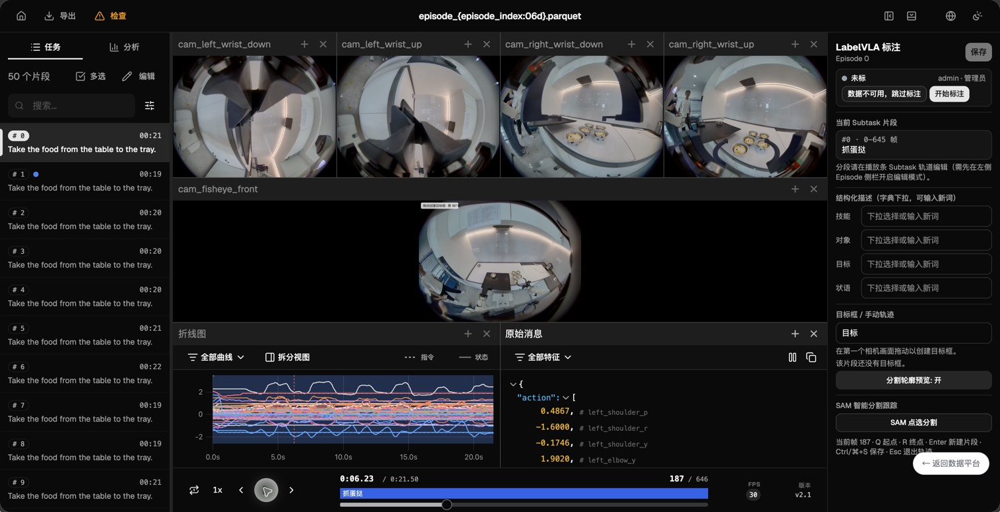
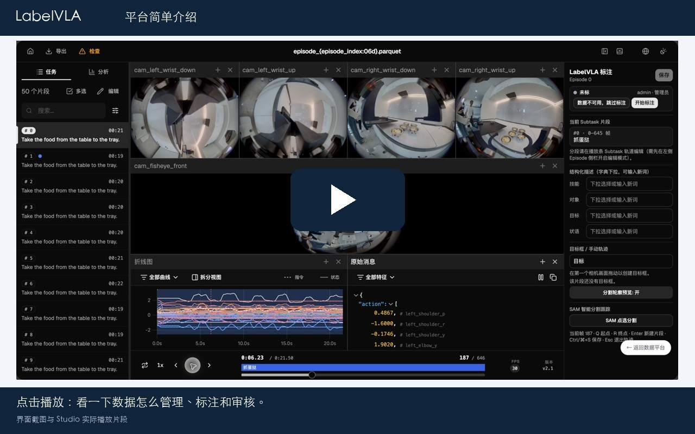
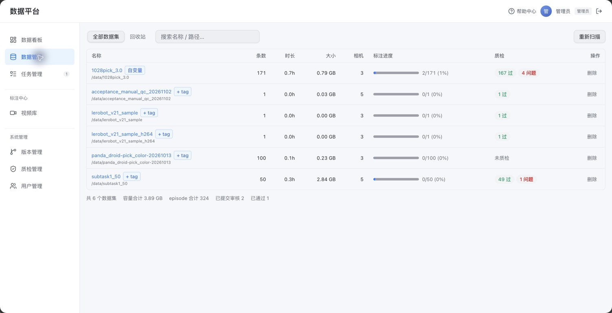
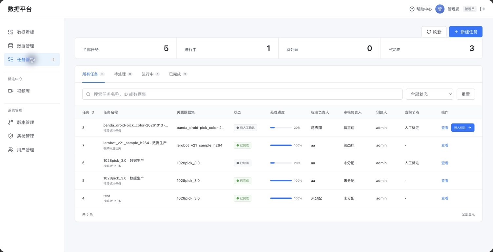
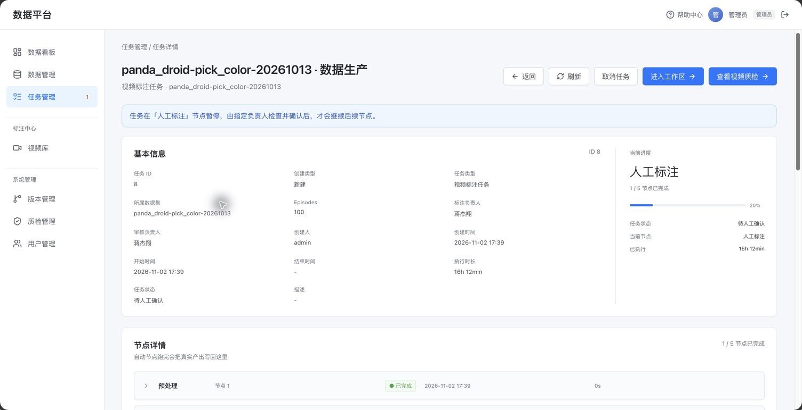
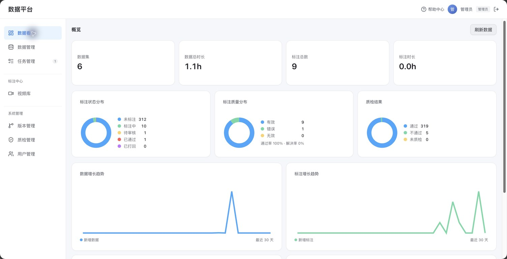

# LabelVLA 数据标注平台

LabelVLA 用来管理和标注机器人数据，支持 LeRobot v2.x / v3.0 格式。基于 LabelVLA 和 LeRobot Studio 开发，提供多相机视频播放、动作片段划分、文本描述、目标框和 SAM 辅助分割。

任务分别指定标注人和审核人。标注完成后，审核人查看视频，通过后再打包发布；有问题就打回重标。每次发布另存一份完整数据集，保留旧版本。

[部署文档](docs/deployment.md) · [GitHub 源码](https://github.com/jiangjiexiang/labelvla) · [Docker 镜像](https://github.com/users/jiangjiexiang/packages/container/package/labelvla)



## 视频介绍

用约 40 秒看一下数据管理、标注、审核和版本保存。视频包含页面截图和 Studio 实际播放片段，没有配音。

[](docs/videos/labelvla-overview.mp4)

[打开或下载视频（MP4，约 0.5 MB）](docs/videos/labelvla-overview.mp4)

## 主要功能

| 功能 | 说明 |
| --- | --- |
| 数据管理 | 查看数据集的条数、时长、容量、相机和标注进度，用机器人标签区分来源 |
| Studio 标注 | 播放视频、逐帧查看、划分动作片段，填写描述和标注目标 |
| SAM 分割 | 点选目标后进行分割与传播跟踪，需要单独部署 SAM 服务 |
| 任务分配 | 创建任务时指定标注负责人和审核负责人，记录节点状态与操作人 |
| 人工质检 | 审核负责人查看视频，确认通过或打回重标 |
| 规则扫描 | 检查缺框、框出界、面积突变和轮廓缺失等问题 |
| 跳过数据 | 不可用的 Episode 可确认跳过，保留原文件和已有标注，也可恢复 |
| 版本保存 | 视频、Parquet、元数据和标注一起复制，每个版本独立保存 |
| 用户管理 | 管理员、标注员和审核员角色，支持账号启用、禁用及登录记录 |

## SAM 3.1 辅助标注

SAM 用来辅助分割和跟踪目标，操作入口在 Studio 右侧的“SAM 智能分割跟踪”。

1. 先在时间轴中选择要标注的动作片段。
2. 点击“SAM 点选分割”，选择相机。首次使用会上传视频并建立会话。
3. 在画面中点击目标；选多了可以按住 Shift 点击背景，继续修正。
4. 点击“传播跟踪”，在当前片段内生成逐帧目标框和轨迹。
5. 等轮廓保存完成后，按 `Ctrl/⌘+S` 保存标注。刷新后再检查框和轮廓是否保留。

SAM 推理服务独立部署，不包含在平台镜像内。当前介绍视频展示了操作入口，还没有演示完整的分割和传播过程。

## 使用流程

1. 将 LeRobot 数据集放入数据目录，按机器人设置标签。
2. 新建任务，选择数据集、标注负责人和审核负责人。
3. 在 Studio 中标注动作片段和目标，完成后提交。
4. 审核人查看视频；通过后继续，打回后重新标注。
5. 打包并发布新版本，保存完整数据包和文件校验清单。

`V1.0`、`V2.0` 表示发布顺序。新版本不会覆盖旧版本，但 V1.0 不一定是采集原始数据，原始数据需要单独备份。

## 页面截图

### 数据管理

名称后面显示机器人标签，点击名称查看数据，已有标签可直接选用。



### 任务管理

任务列表显示负责人和进度，详情页查看每个节点的状态及操作记录。



<details>
<summary>查看任务详情</summary>



</details>

<details>
<summary>查看数据看板</summary>



</details>

## 部署

目前使用单机 Docker 部署。镜像 `ghcr.io/jiangjiexiang/labelvla:0.2.1` 提供 Linux amd64 基础环境，平台代码和数据通过宿主机目录挂载。

**仅拉取镜像还不能完整运行平台**，需要准备代码、构建前端并挂载数据目录。具体步骤见[部署、更新与迁移](docs/deployment.md)。

```text
labelvla-docker/
├── integration-v2/
│   ├── studio-src/       # 前端源码
│   └── studio/           # 前端构建结果与 Python 后端
│       ├── bridge.py
│       └── bridge_ext/   # 用户、任务、质检和版本等接口
├── labelVLA-main/        # LabelVLA 基础代码
├── data/                # 数据集和运行数据，不提交 Git
└── docs/                # 文档与截图
```

标注保存在数据集的 `segments/` 中，平台数据库位于 `/data/.platform/platform.db`。前端 `studio/assets/` 是构建产物，不纳入 Git。

钉钉通知模块默认关闭，实际 @效果尚待验证。配置方法见[钉钉通知说明](docs/dingtalk.md)。

## 其他文档

- [平台设计](docs/platform-design.md)
- [开发任务拆分](docs/platform-plan.md)
- [数据集版本](docs/dataset-versions.md)
- [SAM 接口约定](docs/sam3-api-requirements.md)

使用及分发时请保留上游组件的许可证和版权声明。
